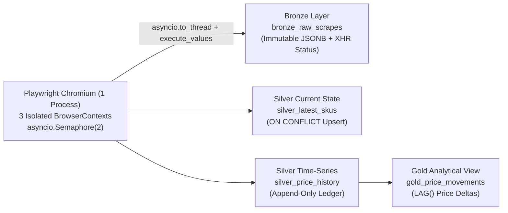

# Pulse Commerce Engine

[](https://github.com/pratheep537/pulse-commerce-engine/actions/workflows/ci.yml)

An async, multi-context Playwright ingestion pipeline in Python that scrapes an AJAX-rendered e-commerce catalog across 3 simulated regional dark-store zones (`BLR-KORAMANGALA`, `CHN-ADYAR`, `CBE-PNPALAYAM`), persists into a **Bronze → Silver → Gold** PostgreSQL 17 warehouse via Docker Compose, and enforces two-run idempotency assertions in GitHub Actions CI.

## Architecture



## Key Engineering Decisions

| Concern | Implementation | Why It Matters |
| :--- | :--- | :--- |
| **Concurrency & Memory** | 1 Chromium process + 3 `BrowserContext`s bounded by `asyncio.Semaphore(2)` | Avoids spawning 3 full browser binaries (~1 GB+ RAM) while keeping cookies and storage isolated per zone. |
| **Deterministic AJAX Wait** | `page.wait_for_function(...)` verifying both active `data-id` and changed first product `href` | Eliminates flaky `time.sleep()` calls and never blocks the `asyncio` event loop. |
| **Non-Blocking DB I/O** | `asyncio.to_thread` + `psycopg2.extras.execute_values` + in-batch PK deduplication | Offloads synchronous `psycopg2` calls from the event loop and prevents `CardinalityViolation` on `ON CONFLICT DO UPDATE`. |
| **Forensic Observability** | `context.tracing` discarded on success, flushed to `artifacts/*.zip` only on exception | Zero disk bloat on healthy runs; automatic trace artifact upload (`if: failure()`) in GitHub Actions. |
| **Container Hardening** | `init: true`, `shm_size: "1gb"`, pinned `v1.64.1-noble`, `pg_isready` healthchecks | Prevents PID 1 Chromium zombie processes, `/dev/shm` 64 MB OOM crashes, Playwright binary mismatches, and Postgres cold-start races. |
| **Financial & Time Precision** | `NUMERIC(10, 2)` and `TIMESTAMPTZ` | Prevents IEEE-754 float drift on `price_delta` and timezone skew between local dev (`IST`) and CI (`UTC`). |

## Quickstart (Docker Compose)

```powershell
# 1. Start fresh Postgres 17 warehouse and build worker image
docker compose down -v
docker compose build

# 2. Execute two consecutive runs to verify idempotency and populate LAG() history
docker compose run --rm scraper-worker
docker compose run --rm scraper-worker

# 3. Verify Bronze / Silver / Gold counts (expected: 18 / 54 / 108 / 54)
docker exec pulse-warehouse psql -U pulse -d warehouse -c "
SELECT 'bronze_raw_scrapes' AS layer, COUNT(*) AS rows FROM bronze_raw_scrapes
UNION ALL
SELECT 'silver_latest_skus', COUNT(*) FROM silver_latest_skus
UNION ALL
SELECT 'silver_price_history', COUNT(*) FROM silver_price_history
UNION ALL
SELECT 'gold_with_previous_price', COUNT(*) FROM gold_price_movements WHERE previous_price IS NOT NULL;
"
```

> **Note on `sql/init.sql`:** PostgreSQL only executes `/docker-entrypoint-initdb.d/init.sql` when the `pgdata` volume is empty. After any DDL edit, run `docker compose down -v` before starting up.

## Repository Layout

```text
pulse-commerce-engine/
├── .github/workflows/ci.yml   # Postgres 17 service container + 2-run CI assertions + trace upload
├── sql/init.sql               # Bronze, Silver, and Gold (LAG view) DDL
├── src/pipeline.py            # Async multi-context Playwright scraper & Postgres loader
├── artifacts/                 # Failure-only Playwright .zip traces (gitignored)
├── Dockerfile                 # Pinned mcr.microsoft.com/playwright/python:v1.64.1-noble
├── docker-compose.yml         # Healthchecked Postgres 17 + hardened scraper-worker
└── requirements.txt           # Pinned playwright==1.64.1 & psycopg2-binary
```
